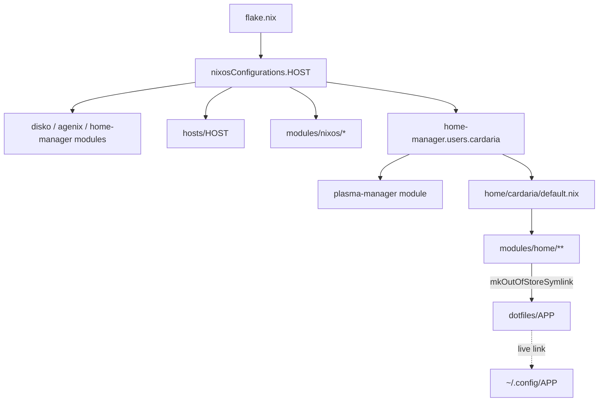

# Architecture

How `flake.nix`, each host, the shared NixOS modules, Home Manager and the live
`dotfiles/` tree combine into one system. Everything is composed by
**explicit imports**: no auto-discovery, no host factory.

## Assembly



One `nixos-rebuild` builds and activates both the system and the user
environment. Home Manager runs with `useGlobalPkgs` (same nixpkgs as the
system) and `useUserPackages` (user packages land in
`/etc/profiles/per-user/cardaria`).

## Who owns what

| Path | Responsibility |
| --- | --- |
| `hosts/<host>/` | One machine: identity, locale, users, boot, kernel, hardware, storage, host-only mounts (`default.nix` imports them) |
| `modules/nixos/desktop.nix` | Plasma 6 and its apps, graphics, audio, Bluetooth, power, GVfs |
| `modules/nixos/login.nix` | Plasma Login Manager |
| `modules/nixos/1password.nix` | 1Password GUI + CLI system integration |
| `home/cardaria/default.nix` | User identity, XDG user dirs, the `dotfile` helper, the HM import list |
| `modules/home/apps/default.nix` | Package-only apps and default-app associations |
| `modules/home/apps/<app>.nix` | Apps with managed config, overrides or services |
| `modules/home/wayland/` | Plasma user settings through plasma-manager, Krohnkite, fonts |
| `modules/home/shell.nix`, `development.nix`, `ssh.nix` | Zsh links; developer tools; SSH client |
| `modules/home/cix/` | The `cix` command: dispatcher and `cix update` |
| `modules/home/llm/` | Local LLM: NInfer profiles behind llama-swap, OpenCode, `cix llm` |
| `modules/home/ocr/` | Chandra OCR 2, `cix ocr`, verified weights in `~/AI` |
| `dotfiles/<app>/` | Native config files, edited live |
| `pkgs/<name>/` | Hand-written packages with provenance |
| `secrets/` | agenix ciphertext and public recipients |

## Live dotfiles

Most apps keep their real config files in `dotfiles/<app>/`. Home Manager
links them into place out of the store with the `dotfile` helper, defined
once in `home/cardaria/default.nix` and available to every HM module:

```nix
{ dotfile, pkgs, ... }:
{
  xdg.configFile."zed".source = dotfile "zed";   # → ~/Repos/cix/dotfiles/zed
}
```

- Edits take effect on the app's reload, with no rebuild. Git tracks the source.
- Ghostty links `config.ghostty` from `dotfiles/ghostty/`; `Ctrl+Shift+,`
  reloads it ([Terminal](../apps/terminal.md#ghostty)).
- Compute entry points are declared by the app modules; the host owns the
  device permissions and group grants ([GPU access](gpu-access.md)).
- `dotfile` wraps `mkOutOfStoreSymlink` with an absolute string path. A Nix
  path (`../../dotfiles/zed`) would copy the files into `/nix/store`, making
  them read-only and stale. Never bypass the helper with a Nix path.
- Apps that save settings by replacing files (Micro, Zed, Spicetify) get
  their whole directory linked, so the atomic rename lands in the checkout.
- KWin writes display changes into its linked `kwinoutputconfig.json`
  ([Plasma](../desktop/plasma.md#display-and-scaling)).
- Other Plasma settings are not live dotfiles: plasma-manager writes the
  declared keys at activation ([Plasma](../desktop/plasma.md)).
- Host-specific variants use `dotfiles/<app>/<host>/` (`dotfiles/kwin/draba/`).

Check a link:

```sh
readlink -f ~/.config/zed     # → /home/cardaria/Repos/cix/dotfiles/zed
```

## Where does a new thing go?

| Adding… | Put it in |
| --- | --- |
| a GUI/CLI app with no config | `modules/home/apps/default.nix` |
| an app with config, override or service | new `modules/home/apps/<app>.nix` + import in `home/cardaria/default.nix` + `dotfiles/<app>/` |
| a dev tool | `modules/home/development.nix` |
| a system service for the desktop | `modules/nixos/desktop.nix` |
| something hardware-specific | `hosts/<host>/` |
| a package missing from nixpkgs | `pkgs/<name>/` ([Nix packaging](../dev/nix-packaging.md)) |

Then register the new module in [`_sources.yaml`](../_sources.yaml).
ChatGPT follows this pattern: `apps/chatgpt.nix` holds its temporary version
override and is explicitly imported by `home/cardaria/default.nix`.

## Adding another host

1. Create `hosts/<host>/` with a `default.nix` and its own hardware, storage,
   boot and GPU config. Never copy another host's disk IDs, PCI selectors
   or monitor identity.
2. Add `nixosConfigurations.<host>` to `flake.nix`, reusing `modules/nixos/*`
   and the user where appropriate.
3. Give a desktop host its own `dotfiles/kwin/<host>/kwinoutputconfig.json`.
4. Give it its own age identity and add its `.pub` as a recipient ([Secrets](../security/secrets.md)).
5. Write `wiki/architecture/<host>.md` and add a row to the README's Hosts table.

Coding agents follow the `add-host` skill.

## Troubleshooting

| Symptom | Fix |
| --- | --- |
| HM activation fails with "would be clobbered" | an unmanaged file already exists at the target. Back it up and remove it, then rebuild |
| Edits in `dotfiles/` have no effect | `readlink -f` the target. A store path means a Nix path was used instead of a string |
| New module silently ignored | not imported in `home/cardaria/default.nix`/`flake.nix`, or untracked (Git flakes skip untracked files) |

## Related

- [Flake](flake.md) · [draba](draba.md) · [Constraints](../constraints.md)
- memory: `live-dotfiles-out-of-store`
