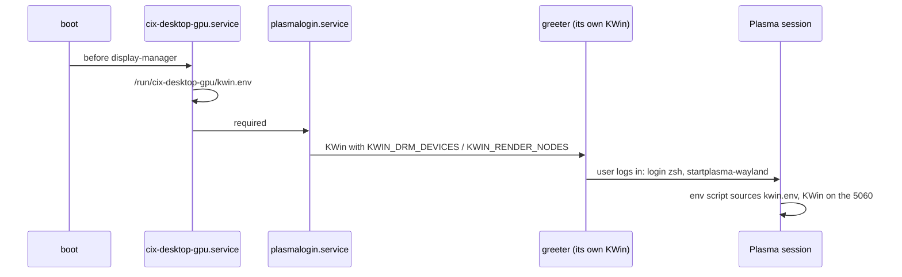

# Login

Plasma Login Manager shows the greeter on the desktop GPU (the RTX 5060 LP)
and starts the Plasma (Wayland) session. PAM unlocks KWallet with the login
password.

## Flow

- `modules/nixos/login.nix` enables the login manager. Plasma's module
  makes Plasma (Wayland) the default session.
- Mouse and touchpad settings follow the desktop: `plasmalogin-input-settings.service`
  runs as the desktop user and copies `~/.config/kcminputrc` into
  `/run/cix-plasmalogin-input/`. The greeter's config links to that copy.
  A path unit runs it again whenever System Settings saves the file; the
  next login screen uses the new speed.
- The wallpaper follows the desktop: `plasmalogin-wallpaper.service` reads the
  image path from `~/.config/plasma-org.kde.plasma.desktop-appletsrc` and
  copies the image as the desktop user to `/run/cix-plasmalogin-wallpaper/wallpaper`.
  The declared `/etc/plasmalogin.conf` points the greeter at that file. A path unit
  runs it again whenever Plasma rewrites that file, so a new wallpaper needs no
  rebuild; the login screen shows it the next time it starts.
- `environment.etc` declares the exact nested KConfig section in `/etc/plasmalogin.conf`;
  the native INI generator escapes those brackets. The copy services have no root
  file access and cannot modify system files.
- The greeter's KWin is pinned to the 5060 by a drop-in on
  `plasma-login-kwin_wayland.service` ([Plasma](plasma.md#gpu-selection)).
- The greeter reads `/var/lib/plasmalogin/.config/kwinoutputconfig.json`, a
  store copy of `dotfiles/kwin/draba/kwinoutputconfig.json` declared in
  `hosts/draba/graphics.nix`: the saved mode and scale for each display connection.
  Both connections use 150% scale; DisplayPort uses 160 Hz and HDMI uses 144 Hz.
  A display change made in the session reaches the greeter after the next rebuild.
- With DisplayPort, the kernel console, greeter and session use
  160 Hz to avoid a mode switch between them
  ([draba](../architecture/draba.md#early-kms-and-console-mode)).
- The greeter's keyboard layout comes from `services.xserver.xkb.layout`
  through `org.freedesktop.locale1`.

## Secrets

KWallet is the only secret store (`org.freedesktop.secrets`); GNOME Keyring
is not installed. Plasma's module adds `kwallet-pam` to the `login` PAM
stack, which the login manager and the lock screen use, so the wallet opens
at password login when its password equals the account password. Passwords
themselves live in 1Password.

## Recovery

If the greeter doesn't come up (black screen, or a login loop):

1. `Ctrl+Alt+F2` → log in on the TTY.
2. `journalctl -b -u cix-desktop-gpu -u display-manager` and
   `journalctl -b _UID=$(id -u plasmalogin)`.
3. Go back to the previous generation:
   `sudo nixos-rebuild switch --rollback --no-reexec`, or pick the older
   entry in GRUB at boot.

## Workflows

**Changing `login.nix` or the login manager** restarts it on activation,
which ends the graphical session. Save your work, log out, switch to TTY2
(`Ctrl+Alt+F2`) and run the activation there.

## Troubleshooting

| Symptom | Fix |
| --- | --- |
| No greeter, TTY works | `systemctl status cix-desktop-gpu`: the selector must find exactly one 5060 |
| Greeter on the wrong scale or rate | `ls -l /var/lib/plasmalogin/.config/kwinoutputconfig.json` should point into the store; rebuild after changing the dotfile |
| Login returns to the greeter | `journalctl --user -b -u plasma-kwin_wayland -u plasma-plasmashell` |
| Black screen for seconds around login | a mode switch: compare `video=` in `hosts/draba/graphics.nix` with `kscreen-doctor -o` |
| KWallet asks for a password after login | the wallet password differs from the account password; change it in KWallet Manager |
| Login screen mouse speed differs from the desktop | `systemctl status plasmalogin-input-settings.path plasmalogin-input-settings.service`; the greeter picks up a copy only when it starts |
| Login wallpaper differs from the desktop | `systemctl status plasmalogin-wallpaper.path plasmalogin-wallpaper.service`; `/etc/plasmalogin.conf` should name `/run/cix-plasmalogin-wallpaper/wallpaper` |
| Wrong keyboard layout at the greeter | `localectl status` should show X11 layout `se` |

## Related

- [Plasma](plasma.md) · [draba](../architecture/draba.md) · [Boot & recovery](../system/boot.md)
- memory: `rtx5060-display-rtx5090-compute`, `plasma-kwin-gpu-env`
